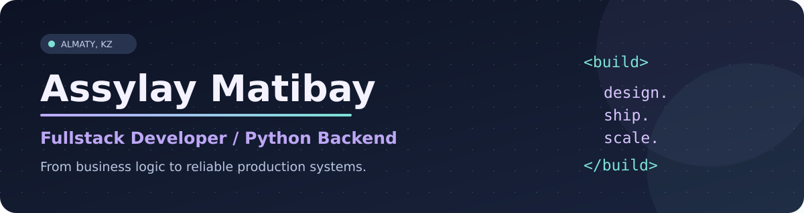

<div align="center">
 

  <br />

  **Fullstack Developer · Backend Engineering · Business Automation**

  Based in Almaty, Kazakhstan · Master's student in Mathematics at SDU University

  [](https://github.com/asekaellaly)
  
</div>

### About me

I build software that connects **business processes, people, and data**. My work covers the entire development lifecycle: architecture, APIs, frontend, databases, third-party integrations, deployment, and production support.

- Built and maintained **17+ web systems** for a network of **7 medical clinics** as the sole developer.
- Developed production **ERP and logistics platforms**, including warehouse accounting, settlements, and transport workflows.
- Especially interested in **Python backend engineering**, scalable applications, and thoughtful product design.
- Studying **Mathematics (MSc)**, with an interest in machine learning and applied research.

### Tech stack

**Backend**

   

**Frontend**

   

**Data & infrastructure**

    

`SQLAlchemy` · `PostGIS` · `MySQL` · `REST APIs` · `Git` · `PM2` · `Bitrix24` · `Webkassa` · `Telegram Bot API`

### Selected production work

> Many of these systems were developed for companies and are not available as public source code. The descriptions below highlight my responsibilities without disclosing proprietary implementation details.

| Project | What I built | Core stack |
| :--- | :--- | :--- |
| **ClinicEX CRM** | Multi-branch clinical operations, cashier workflows, mixed payments, refunds, fiscal receipts, and POS integrations | FastAPI · Next.js · PostgreSQL |
| **Patient Scheduling** | Branch calendars, role-based access, Bitrix24 synchronization, and deployment for new branches | FastAPI · React · PHP · Vue 2 · MySQL |
| **HR Platform & LMS** | Employee records, HR dashboards, protected training content, and AI-assisted candidate assessments | React · TypeScript · Node.js · PostgreSQL |
| **Distribution ERP** | Orders, warehouse, settlements, document registers, balances, and 1C reconciliation | Python · FastAPI · PostgreSQL |
| **Logistics Platform** | Driver and route accounting, bilingual Telegram bot, freight requests, and transport workflows | FastAPI · SQLAlchemy · PostGIS · aiogram 3 |

### What I care about

```text
01  Clear architecture and maintainable code
02  Reliable APIs and consistent data
03  Business workflows that actually make sense
04  Ownership from first commit to production
```

### GitHub activity

<div align="center">
  
  
</div>

<sub>Public GitHub activity represents only part of my work. Most commercial projects are hosted privately.</sub>

---

<div align="center">
  <strong>Building practical systems with care for the details.</strong><br />
  <sub>© Assylay Matibay · Almaty, Kazakhstan</sub>
</div>
